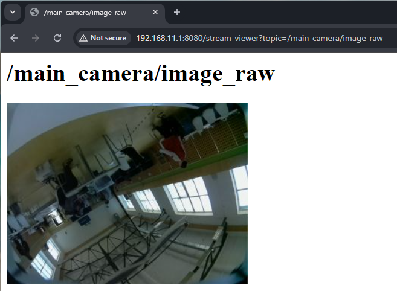
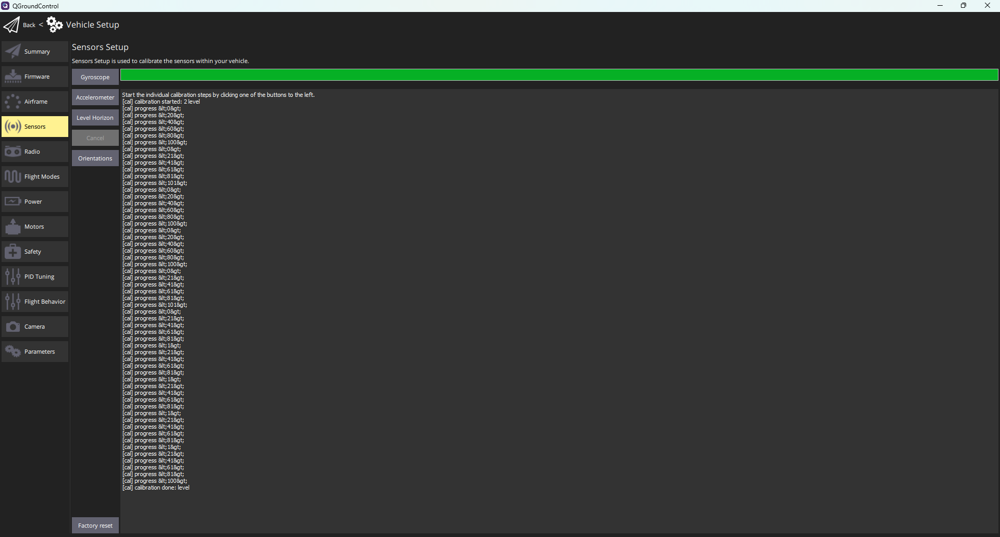
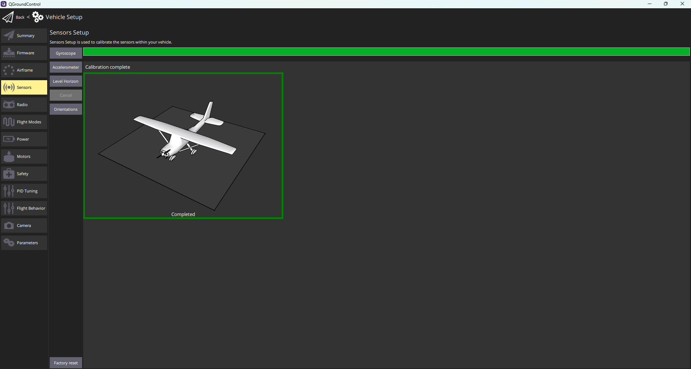
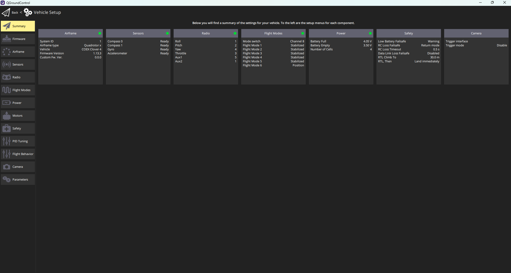
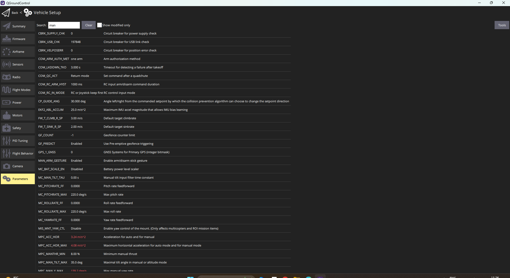
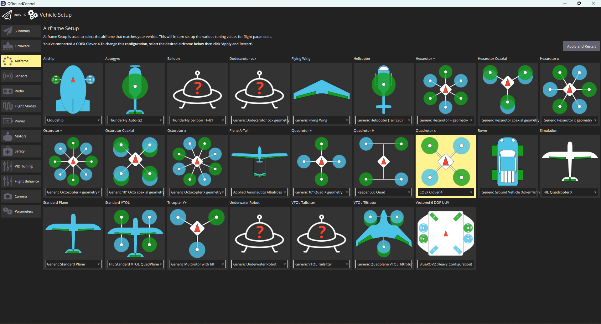
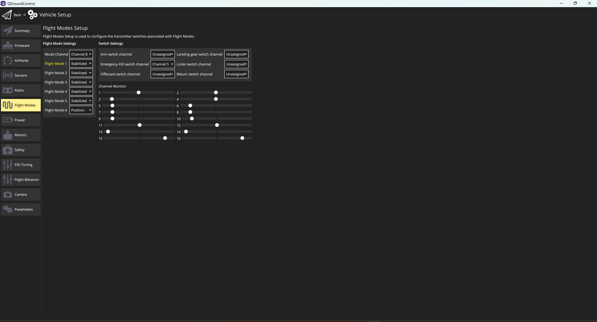

Certainly! Below is the complete Markdown code for the drone preparation guide:

```markdown
# Drone Preparation Guide

To prepare and assemble your drone for flight, follow these detailed steps to establish a connection, verify settings, and update parameters.

## Step 1: Establish SSH Connection
1. **Connect the UAV**: Ensure the drone is connected to the network.
2. **SSH Connection**: Use the following command to connect via SSH:
   ```bash
   ssh root@<drone-ip-address> -p 22
   ```
   Replace `<drone-ip-address>` with the actual IP address of your drone. If you encounter issues connecting (e.g., "Connection timed out"), ensure that port 22 is open and accessible from your network.

## Step 2: Verify Drone Settings
Once connected, you can perform command line operations inside the Clover environment.

### Camera Configuration
- Verify that the camera is properly configured. You should see a connection confirmation similar to this:
  

### Calibration and Sensor Status
1. **Calibration Connection**: Check the calibration connection or sensor status:
   
   
2. **Sensor Status**: After calibration, verify the sensor status:
   

### Data Verification
Ensure that the sensor displays the necessary data as shown in this image:


## Step 3: Update Drone Parameters
After confirming that the sensor and calibration are successful, proceed to update the required parameters within the drone:


## Step 4: Verify Airframe Availability
Check if your drone is correctly listed under the airframe settings:


## Step 5: Adjust Flight Modes
Finally, update the flight modes according to your operational needs:


By following these steps, you can ensure that your drone is fully prepared for flight and all systems are functioning correctly.
```

You can copy and paste this code into any Markdown editor or viewer to see it formatted properly.