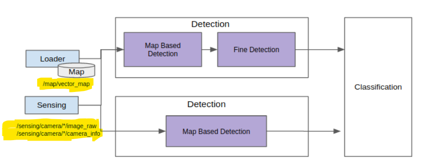
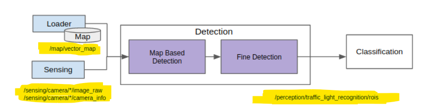
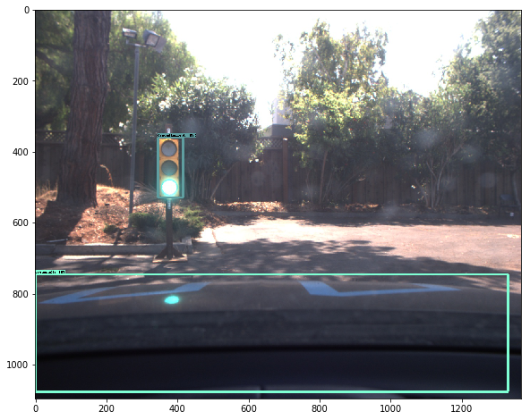
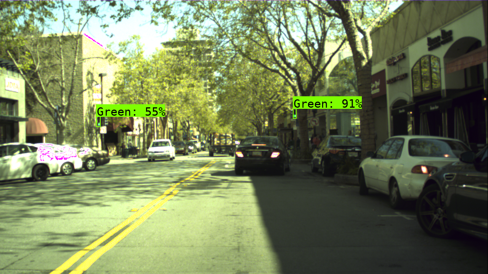

# Table of Contents

1. [System Components](#system-components)
   - [1. Traffic Light Localization](#1-traffic-light-localization)
   - [2. Traffic Light Detection](#2-traffic-light-detection)
   - [3. Traffic Light Recognition](#3-traffic-light-recognition)

2. [Datasets Used](#datasets-used)

3. [Detailed Description](#detailed-description)
   - [Algorithms and Methods](#algorithms-and-methods)
   - [Documentation Requirements](#documentation-requirements)

4. [Detection in Traffic Light Recognition](#detection-in-traffic-light-recognition)
   - [Use Cases and Requirements](#use-cases-and-requirements)
   - [Role of the Detection Module](#role-of-the-detection-module)
     - [Input and Output Specifications](#input-and-output-specifications)
       - [Inputs](#inputs)
       - [Outputs](#outputs)
   - [Design Considerations](#design-considerations)

5. [Design](#design)

6. [Conclusion](#conclusion)

## System Components

### 1. Traffic Light Localization
- **Description**: The traffic light localization phase involves preprocessing the images utilized in the project to accurately identify the areas where traffic lights are located.
- **Functionality**: This step ensures that the images are enhanced and prepared for further analysis, allowing for effective identification of traffic light regions.

### 2. Traffic Light Detection
- **Description**: This phase focuses on the precise screening of the traffic light areas identified during the localization step.
- **Functionality**: Utilizing advanced algorithms, this part refines the search results to ensure that only relevant traffic light areas are considered for recognition.

### 3. Traffic Light Recognition
- **Description**: The final phase is dedicated to classifying the detected traffic lights based on their colors—red, yellow, and green.
- **Functionality**: This recognition process enables accurate interpretation of traffic signals, which is crucial for applications such as traffic management and autonomous vehicle navigation.

## Datasets Used
- **Bosch Small Traffic Lights Dataset**: This dataset provides a collection of images specifically designed for training models in detecting and recognizing traffic lights. [Neural Network 1](https://github.com/KirtiRamchandani/UAV2024/tree/main/Module_B/Neural_Network_1)
- **Faster R-CNN based on TensorFlow**: The project utilizes the Faster R-CNN architecture implemented in TensorFlow for effective object detection and classification of traffic lights. (Neural Network 2)

## Detailed Description

### Algorithms and Methods
  - The project employs advanced algorithms such as Faster R-CNN to analyze data from cameras and sensors. This includes:
  - Preprocessing techniques for image enhancement.
  - Object detection methods to locate and classify traffic lights.

### Documentation Requirements
The documentation will include:
- Diagrams illustrating the workflow of the traffic light detection system.
- Drawings detailing the architecture of the algorithms used.
- Charts and graphs that visualize the data analysis process, including performance metrics of the model.
- Prototypes of user interfaces displaying real-time data analysis results from traffic light detection.
- Videos demonstrating the operation of the system in various scenarios, showcasing its effectiveness in real-world applications.

### Let's have a look at one of the implementation for better idea of Neural Network and how transformation tree works.

## Detection in Traffic Light Recognition

Detection in Traffic Light Recognition is a critical component for ensuring the safe operation of autonomous vehicles at intersections. This module plays a vital role in interpreting traffic signals, enabling vehicles to make informed decisions based on real-time visual data.

## Use Cases and Requirements

The primary use cases for traffic light detection include:

- **Passing an Intersection When the Traffic Signal is Green**: The detection system must accurately identify green signals to allow vehicles to proceed safely through intersections without stopping.
  
- **Stopping at an Intersection When the Traffic Signal is Red**: It is essential for the system to recognize red signals promptly, ensuring that vehicles come to a complete stop, thereby preventing accidents and ensuring compliance with traffic laws.

For a comprehensive understanding of the specific requirements related to these use cases, refer to the detailed documentation provided for the Perception stack.

## Role of the Detection Module

The detection module in Traffic Light Recognition is tasked with identifying the **Region of Interest (ROI)** for traffic lights within images captured by onboard cameras. In complex environments, such as busy intersections, an image may contain multiple traffic signals. However, not all of these signals are relevant to the vehicle's immediate navigation needs.

To enhance detection accuracy and efficiency, the system leverages map information. This data helps narrow down the focus to specific areas within the image that are most likely to contain traffic lights pertinent to the vehicle's trajectory. By doing so, it minimizes unnecessary processing of irrelevant signals, allowing for quicker and more reliable decision-making.

### Input and Output Specifications

#### Inputs
The detection module relies on various input data types:

| Input          | Data Type                      | Topic                          |
|----------------|--------------------------------|--------------------------------|
| Camera         | `sensor_msgs::Image`          | `/sensing/camera/*/image_raw` |
| Camera Info    | `sensor_msgs::CameraInfo`     | `/sensing/camera/*/camera_info` |
| Map            | `autoware_lanelet2_msgs::MapBin` | `/map/vector_map`             |
| TF             | `tf2_msgs::TFMessage`         | `/tf`                          |

#### Outputs
The processed output from the detection module includes:

| Output                            | Data Type                               | Output Module                               | Topic                                         |
|-----------------------------------|-----------------------------------------|--------------------------------------------|-----------------------------------------------|
| Cropped Traffic Light ROI Information | `autoware_perception_msgs::TrafficLightRoiArray.msg` | Traffic Light Recognition: Classification | `/perception/traffic_light_recognition/rois` |

## Design Considerations

The design of the detection module emphasizes modularity and robustness in detecting traffic light ROIs. A notable feature of this implementation is its dual-stage detection approach. Initially, it employs a **Map-Based Detection** strategy that provides rough ROIs based on pre-existing map data. This method effectively mitigates issues related to calibration errors that can arise when relying solely on map data.

Following this initial detection phase, a **Fine Detection** process refines these rough ROIs to yield precisely cropped images of traffic signals. This two-step approach not only enhances accuracy but also ensures that minor calibration discrepancies do not hinder overall performance.

By integrating advanced detection techniques with real-time data processing capabilities, this module significantly contributes to the safety and efficiency of autonomous driving systems at intersections.

## Design

The Detection module is designed to modularize various patterns for detecting the Region of Interest (ROI) of traffic lights. This modular approach enhances flexibility and allows for the integration of different detection strategies, ensuring robust performance in diverse traffic scenarios.

The below one would tell how the implementation in the model would work:

## Neural Network Detection Output:

## Conclusion
This system aims to enhance urban traffic management through efficient localization, detection, and recognition of traffic lights using state-of-the-art computer vision and AI technologies.
