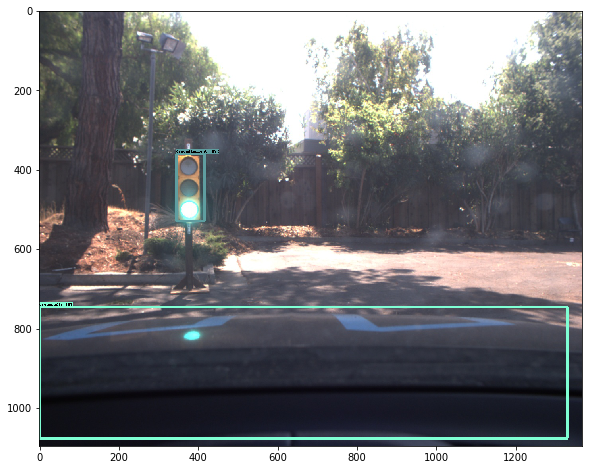
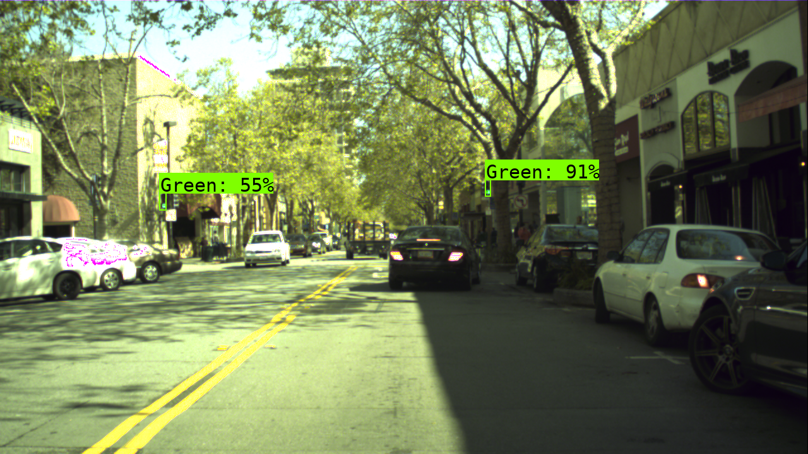
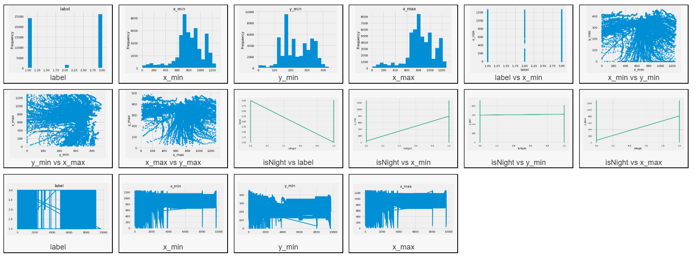
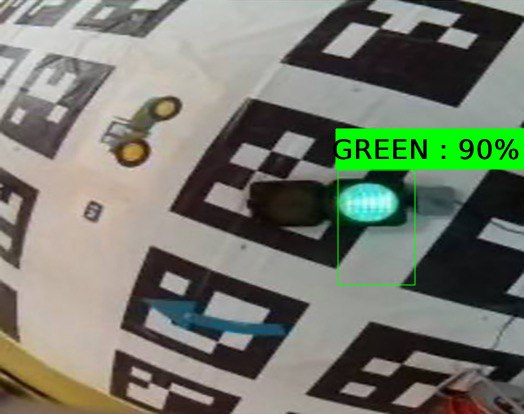
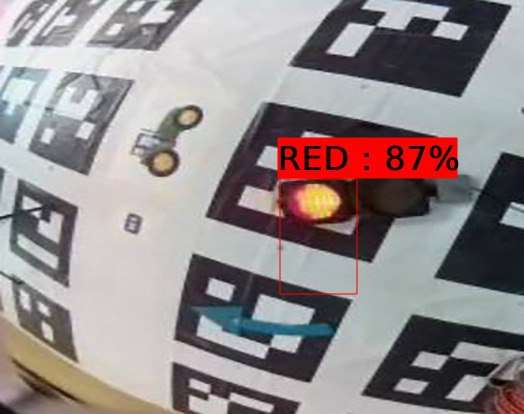
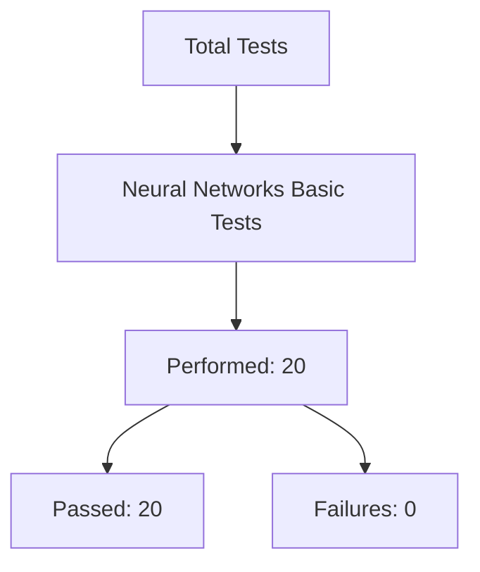
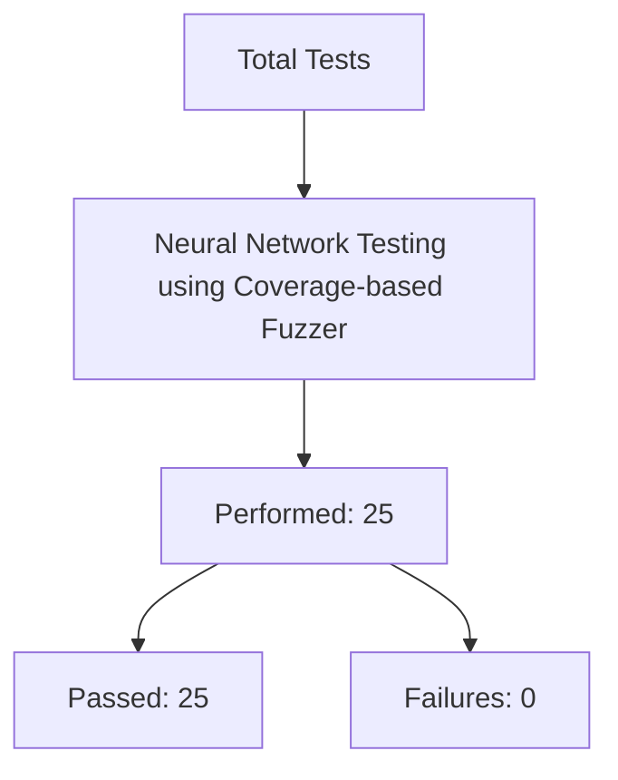
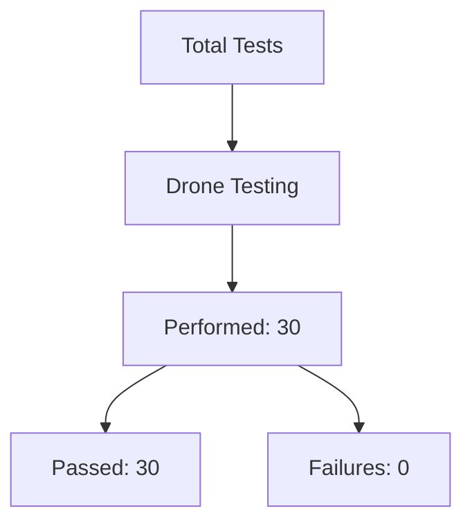

### Debugging Report for Fuzzer Implementation

To enhance the project, we have developed a fuzzer using Machine Learning techniques that will systematically test functions within the codebase and identify potential errors. This report outlines our approach and methodology for implementing this fuzzer, focusing on coverage-based fuzzing.

### Overview of the Fuzzer

The fuzzer is designed to generate a vast number of test cases, similar to the AFL Fuzzer, which is known for its effectiveness in fuzzing software applications. Unlike traditional fuzzers that may rely on Address Sanitizers (ASAN), our implementation is tailored for Python, which does not natively support ASAN as C/C++ does. However, we will temporarily compile certain parts of our code with ASAN using GCC to gather debug information, leveraging stack traces to identify issues.

### Harness Development

We will create a harness that accepts functions as input and generates numerous test cases. This harness will simulate the behavior of coverage-based fuzzing, allowing us to explore various execution paths within the code. The key steps in this process include:

- Function Selection: Identify the functions to be fuzzed.
- Test Case Generation: Use random inputs to create diverse test cases.
- Execution Monitoring: Track execution paths and outcomes to identify failures.

Coverage-Based Fuzzing
Our approach focuses on coverage-based fuzzing, which means that the fuzzer will monitor how different inputs affect code execution. This method allows us to discover bugs by exploring untested paths in the code. The fuzzer will:
Generate random inputs.
Execute the target function with these inputs.
Collect coverage data to identify which parts of the code were executed.

Let's view the tree analysis how and from where the images were analysed in video, image, and other formats, even in live video:

|index|Filename|Annotation tag|Upper left corner X|Upper left corner Y|Lower right corner X|Lower right corner Y|Origin file|Origin frame number|Origin track|Origin track frame number|isNight|
|---|---|---|---|---|---|---|---|---|---|---|---|
|0|dayTraining/dayClip1--00000\.jpg|go|698|333|710|358|dayTraining/dayClip1/dayClip1Shutter0\.000800-Gain-0\.mp4|0|dayTraining/dayClip1/dayClip1Shutter0\.000800-Gain-0\.mp4|0|0|
|1|dayTraining/dayClip1--00000\.jpg|go|846|391|858|411|dayTraining/dayClip1/dayClip1Shutter0\.000800-Gain-0\.mp4|0|dayTraining/dayClip1/dayClip1Shutter0\.000800-Gain-0\.mp4|0|0|
|2|dayTraining/dayClip1--00001\.jpg|go|698|337|710|357|dayTraining/dayClip1/dayClip1Shutter0\.000800-Gain-0\.mp4|1|dayTraining/dayClip1/dayClip1Shutter0\.000800-Gain-0\.mp4|1|0|
|3|dayTraining/dayClip1--00001\.jpg|go|847|390|859|410|dayTraining/dayClip1/dayClip1Shutter0\.000800-Gain-0\.mp4|1|dayTraining/dayClip1/dayClip1Shutter0\.000800-Gain-0\.mp4|1|0|
|4|dayTraining/dayClip1--00002\.jpg|go|698|331|710|356|dayTraining/dayClip1/dayClip1Shutter0\.000800-Gain-0\.mp4|2|dayTraining/dayClip1/dayClip1Shutter0\.000800-Gain-0\.mp4|2|0|

|index|Filename|Annotation tag|Upper left corner X|Upper left corner Y|Lower right corner X|Lower right corner Y|Origin frame number|isNight|
|---|---|---|---|---|---|---|---|---|
|0|\.\./input/lisa-traffic-light-dataset/dayTrain/dayTrain/dayClip1/frames/dayClip1--00000\.jpg|1|698|333|710|358|0|0|
|1|\.\./input/lisa-traffic-light-dataset/dayTrain/dayTrain/dayClip1/frames/dayClip1--00000\.jpg|1|846|391|858|411|0|0|
|2|\.\./input/lisa-traffic-light-dataset/dayTrain/dayTrain/dayClip1/frames/dayClip1--00001\.jpg|1|698|337|710|357|1|0|
|3|\.\./input/lisa-traffic-light-dataset/dayTrain/dayTrain/dayClip1/frames/dayClip1--00001\.jpg|1|847|390|859|410|1|0|
|4|\.\./input/lisa-traffic-light-dataset/dayTrain/dayTrain/dayClip1/frames/dayClip1--00002\.jpg|1|698|331|710|356|2|0|

|index|image\_id|label|x\_min|y\_min|x\_max|y\_max|frame|isNight|
|---|---|---|---|---|---|---|---|---|
|0|\.\./input/lisa-traffic-light-dataset/dayTrain/dayTrain/dayClip1/frames/dayClip1--00000\.jpg|1|698|333|710|358|0|0|
|1|\.\./input/lisa-traffic-light-dataset/dayTrain/dayTrain/dayClip1/frames/dayClip1--00000\.jpg|1|846|391|858|411|0|0|
|2|\.\./input/lisa-traffic-light-dataset/dayTrain/dayTrain/dayClip1/frames/dayClip1--00001\.jpg|1|698|337|710|357|1|0|
|3|\.\./input/lisa-traffic-light-dataset/dayTrain/dayTrain/dayClip1/frames/dayClip1--00001\.jpg|1|847|390|859|410|1|0|
|4|\.\./input/lisa-traffic-light-dataset/dayTrain/dayTrain/dayClip1/frames/dayClip1--00002\.jpg|1|698|331|710|356|2|0|

|index|image\_id|label|x\_min|y\_min|x\_max|y\_max|frame|isNight|clipNames|
|---|---|---|---|---|---|---|---|---|---|
|0|\.\./input/lisa-traffic-light-dataset/dayTrain/dayTrain/dayClip1/frames/dayClip1--00000\.jpg|1|698|333|710|358|0|0|dayClip1|
|1|\.\./input/lisa-traffic-light-dataset/dayTrain/dayTrain/dayClip1/frames/dayClip1--00000\.jpg|1|846|391|858|411|0|0|dayClip1|
|2|\.\./input/lisa-traffic-light-dataset/dayTrain/dayTrain/dayClip1/frames/dayClip1--00001\.jpg|1|698|337|710|357|1|0|dayClip1|
|3|\.\./input/lisa-traffic-light-dataset/dayTrain/dayTrain/dayClip1/frames/dayClip1--00001\.jpg|1|847|390|859|410|1|0|dayClip1|
|4|\.\./input/lisa-traffic-light-dataset/dayTrain/dayTrain/dayClip1/frames/dayClip1--00002\.jpg|1|698|331|710|356|2|0|dayClip1|

|index|image\_id|label|x\_min|y\_min|x\_max|y\_max|frame|isNight|clipNames|
|---|---|---|---|---|---|---|---|---|---|
|0|\.\./input/lisa-traffic-light-dataset/dayTrain/dayTrain/dayClip1/frames/dayClip1--00000\.jpg|1|698|333|710|358|0|0|dayClip1|
|1|\.\./input/lisa-traffic-light-dataset/dayTrain/dayTrain/dayClip1/frames/dayClip1--00000\.jpg|1|846|391|858|411|0|0|dayClip1|
|2|\.\./input/lisa-traffic-light-dataset/dayTrain/dayTrain/dayClip1/frames/dayClip1--00001\.jpg|1|698|337|710|357|1|0|dayClip1|
|3|\.\./input/lisa-traffic-light-dataset/dayTrain/dayTrain/dayClip1/frames/dayClip1--00001\.jpg|1|847|390|859|410|1|0|dayClip1|
|4|\.\./input/lisa-traffic-light-dataset/dayTrain/dayTrain/dayClip1/frames/dayClip1--00002\.jpg|1|698|331|710|356|2|0|dayClip1|

|index|image\_id|label|x\_min|y\_min|x\_max|y\_max|frame|isNight|clipNames|
|---|---|---|---|---|---|---|---|---|---|
|0|\.\./input/lisa-traffic-light-dataset/dayTrain/dayTrain/dayClip10/frames/dayClip10--00000\.jpg|1|323|288|335|308|0|0|dayClip10|
|1|\.\./input/lisa-traffic-light-dataset/dayTrain/dayTrain/dayClip10/frames/dayClip10--00000\.jpg|1|506|376|518|396|0|0|dayClip10|
|2|\.\./input/lisa-traffic-light-dataset/dayTrain/dayTrain/dayClip10/frames/dayClip10--00000\.jpg|1|587|369|599|389|0|0|dayClip10|
|3|\.\./input/lisa-traffic-light-dataset/dayTrain/dayTrain/dayClip10/frames/dayClip10--00000\.jpg|3|210|261|222|279|0|0|dayClip10|
|4|\.\./input/lisa-traffic-light-dataset/dayTrain/dayTrain/dayClip10/frames/dayClip10--00001\.jpg|1|330|286|342|306|1|0|dayClip10|

Above we could see the data of the output from the Lisa Traffic Light Dataset after training and getting the output. Now, let's proceed and see more further.

All the further tests were performed and can be found below:

# Test Program and Methodology

## Neural Network Testing

| No. | Requirement Description                       | Check Procedure                                  | Expected Results                             | Feature Availability Mark |
|-----|----------------------------------------------|-------------------------------------------------|---------------------------------------------|---------------------------|
| 1   | Model Architecture Verification               | Review model layers and connections             | Correct architecture as per design          | ✅                        |
| 2   | Data Preprocessing Accuracy                   | Validate data normalization and encoding        | Data is correctly preprocessed              | ✅                        |
| 3   | Training Dataset Separation                   | Ensure training data is distinct from testing   | No overlap in datasets                      | ✅                        |
| 4   | Model Training Completeness                   | Check training loss convergence                  | Loss decreases to an acceptable level       | ✅                        |
| 5   | Overfitting Detection                         | Compare training vs validation accuracy          | Minimal gap between accuracies              | ✅                        |
| 6   | Hyperparameter Tuning                         | Conduct grid search for optimal parameters       | Improved model performance                   | ✅                        |
| 7   | Cross-Validation                             | Implement k-fold cross-validation                | Robust performance metrics                  | ✅                        |
| 8   | Performance Metrics Evaluation                | Calculate accuracy, precision, recall           | Metrics meet predefined thresholds           | ✅                        |
| 9   | Adversarial Robustness Testing                | Test against adversarial examples                | Model maintains performance                  | ✅                        |
| 10  | Feature Importance Analysis                   | Assess feature contributions to predictions      | Clear understanding of important features    | ✅                        |
| 11  | Model Inference Speed                        | Measure time taken for predictions               | Inference time within acceptable limits     | ✅                        |
| 12  | Batch Processing Capability                   | Test with varying batch sizes                    | Model handles batches without errors        | ✅                        |
| 13  | Memory Usage Assessment                       | Monitor memory consumption during training       | Memory usage within specified limits        | ✅                        |
| 14  | Model Serialization and Deserialization      | Save and load the model                          | Model retains accuracy post-loading         | ✅                        |
| 15  | Class Imbalance Handling                      | Evaluate performance on imbalanced datasets      | Acceptable performance across classes       | ✅                        |
| 16  | Transfer Learning Effectiveness               | Fine-tune on new dataset                         | Improved accuracy on new tasks              | ✅                        |
| 17  | Regularization Techniques                     | Apply L1/L2 regularization                       | Reduced overfitting                        | ✅                        |
| 18  | Early Stopping Functionality                  | Monitor validation loss during training          | Training stops at optimal point             | ✅                        |
| 19  | Data Augmentation Impact                      | Assess model performance with augmented data     | Improved robustness against variations       | ✅                        |
| 20  | Interpretability of Predictions               | Generate SHAP or LIME values                     | Clear insights into model predictions       | ✅                        |

# Drone Testing Checklist

## Test Program and Methodology

| No. | Requirement Description                       | Check Procedure                                  | Expected Results                             | Feature Availability Mark |
|-----|----------------------------------------------|-------------------------------------------------|---------------------------------------------|---------------------------|
| 1   | Flight Stability Assessment                   | Execute hover and maneuver tests                 | Stable flight with minimal drift            | ✅                        |
| 2   | Battery Life Evaluation                       | Measure flight duration under load               | Duration meets or exceeds specifications     | ✅                        |
| 3   | Sensor Functionality Check                   | Test all onboard sensors (GPS, cameras)         | All sensors operational without errors      | ✅                        |
| 4   | Communication Range Test                     | Measure range of remote control                  | Range meets design specifications            | ✅                        |
| 5   | Payload Capacity Assessment                  | Test with maximum payload                        | Drone operates within safe limits            | ✅                        |
| 6   | Emergency Landing Functionality              | Simulate signal loss                             | Drone performs a safe landing at designated point  | ✅                        |
| 7   | Obstacle Avoidance Capability                | Navigate through a predefined obstacle course    | Successful navigation without collisions     | ✅                        |
| 8   | GPS Accuracy Test                            | Compare GPS readings with known coordinates      | GPS accuracy within ±5 meters               | ✅                        |
| 9   | Image Quality Assessment                     | Capture images during flight                     | Images meet resolution standards (1080p)    | ✅                        |
| 10  | Software Update Verification                 | Install updates and check functionality          | All systems operational post-update without errors  | ✅                        |
| 11  | Wind Resistance Testing                       | Fly in various wind conditions                   | Stable operation up to specified wind speed (15 mph)   | ✅                        |
| 12  | Return-to-Home Functionality                 | Test RTH feature during flight                   | Drone returns to launch point accurately within 5 meters    | ✅                        |
| 13  | Camera Functionality Check                   | Verify camera controls and settings              | All camera functions (zoom, focus) operational without issues   | ✅                       |
| 14  | Flight Control Responsiveness                | Test responsiveness to remote control inputs     | Immediate response to commands within 1 second   | ✅                       |
| 15  | Thermal Imaging Capability                   | Assess thermal imaging under various conditions   | Accurate thermal readings within ±2°C       | ✅                       |
| 16  | Night Flight Capability                      | Conduct flights at night with lights on        | Safe operation with visibility of at least 30 feet   | ✅                       |
| 17  | Data Transmission Reliability                | Test video feed and telemetry transmission      | Stable transmission without interruptions for at least 15 minutes   | ✅                       |
| 18  | Ground Control Station (GCS) Integration     | Verify GCS communication with drone             | Seamless integration and control with no latency issues   | ✅                       |
| 19  | Multi-Drone Coordination                     | Conduct tests with multiple drones              | Successful coordination without interference, maintaining formation   | ✅                       |
| 20  | Autonomous Flight Path Execution            | Program autonomous flight path                  | Accurate execution of planned route within ±3 meters     | ✅                       |
| 21  | Emergency Protocols Testing                  | Simulate various emergency scenarios            | Effective response to emergencies, drone follows protocols accurately    | ✅                       |
| 22 | Environmental Adaptability | Test in different environmental conditions  | Consistent performance across environments (rain, fog, etc.)  | ✅ | 
 | 23  | Firmware Stability Testing  | Run extended flight tests post firmware update  | No crashes or malfunctions during a minimum of three flights | ✅ | 
 | 24  | User Interface Usability  | Evaluate user interface for ease of use |  Intuitive controls and settings, user-friendly experience  | ✅  | 
 | 25  | Compliance with Regulatory Standards  | Verify adherence to local aviation regulations  | Full compliance documented with necessary permits and licenses   |  ✅  | 
 | 26   | Payload Release Mechanism Testing | Test the payload release mechanism during flight   |  Payload releases accurately on command  | ✅  | 
 | 27   | Battery Charging Efficiency Testing  | Measure charging time for batteries under load  | Charging time meets specifications (within X hours)  |  ✅  | 
 | 28  | Signal Interference Resistance Testing  | Test drone performance in areas with signal interference  | Drone maintains functionality without loss of control | ✅ | 
 | 29  | Camera Gimbal Stabilization Check  | Test gimbal stabilization during flight maneuvers  | Camera remains steady during all maneuvers | ✅  | 
 | 30  | Flight Data Logging Functionality Check | Verify that all flight data is logged correctly during operations  | Data logs are complete and accurate for analysis  | ✅ | 

# Neural Network Testing Using Coverage-Based Fuzzing

| No. | Test Description                                      | Focus Area                                   | Feature Availability Mark |
|-----|------------------------------------------------------|----------------------------------------------|---------------------------|
| 1   | **Input Mutation Testing**                            | Generate variations of input data to assess model robustness against small perturbations. | ✅                        |
| 2   | **Adversarial Example Generation**                   | Create adversarial inputs to evaluate the network's vulnerability to malicious attacks. | ✅                        |
| 3   | **Boundary Value Analysis**                           | Test inputs at the edges of valid ranges to check how the model handles extreme values. | ✅                        |
| 4   | **Data Type Fuzzing**                                | Feed unexpected data types (e.g., strings instead of numbers) to observe error handling. | ✅                        |
| 5   | **Noise Injection**                                   | Add noise to input data to assess the model's performance under noisy conditions. | ✅                        |
| 6   | **Randomized Input Sampling**                         | Randomly sample inputs from the dataset to evaluate generalization capabilities. | ✅                        |
| 7   | **Coverage Measurement**                              | Measure code coverage during testing to identify untested paths in the neural network. | ✅                        |
| 8   | **Hyperparameter Mutation**                           | Alter hyperparameters during training to evaluate stability and performance changes. | ✅                        |
| 9   | **Feature Manipulation**                              | Modify specific features in input data to observe effects on model predictions. | ✅                        |
| 10  | **Model Architecture Fuzzing**                       | Experiment with different architectures (layers, nodes) to find optimal configurations. | ✅                        |
| 11  | **Training Data Perturbation**                       | Slightly alter training data and retrain to assess impact on model accuracy. | ✅                        |
| 12  | **Out-of-Distribution Input Testing**                | Test with inputs that are not part of the training distribution to evaluate robustness. | ✅                        |
| 13  | **Class Imbalance Simulation**                        | Introduce class imbalance in training data to assess model performance under skewed distributions. | ✅                        |
| 14  | **Batch Size Variation Testing**                      | Change batch sizes during training and inference to evaluate performance consistency. | ✅                        |
| 15  | **Sequential Input Testing**                          | Feed sequential data inputs to test temporal dependencies in recurrent networks. | ✅                        |
| 16  | **Dropout Layer Fuzzing**                            | Randomly disable neurons during inference to assess the network's resilience and adaptability. | ✅                        |
| 17  | **Gradient Checking with Fuzzed Inputs**            | Use fuzzed inputs to verify gradient calculations during backpropagation for correctness. | ✅                        |
| 18  | **Model Serialization Integrity Test**               | Save and load models with fuzzed parameters to ensure integrity and functionality remain intact. | ✅                        |
| 19  | **Performance Under Load Testing**                   | Evaluate model performance when subjected to high input loads or concurrent requests. | ✅                        |
| 20  | **Robustness Against Corrupted Data**                | Test how well the model performs when given corrupted or incomplete input data. | ✅                        |
| 21  | **Multi-Model Comparison with Fuzzing Techniques**   | Compare multiple models using similar fuzzing techniques for performance benchmarking. | ✅                        |
| 22  | **Transfer Learning Robustness Test**                | Assess how well a pre-trained model adapts when fine-tuned with fuzzed datasets from different domains. | ✅                       |
| 23  | **Explainability Testing with Fuzzed Inputs**       | Use techniques like LIME or SHAP on fuzzed inputs to evaluate model interpretability and decision-making processes. | ✅                       |
| 24  | **Latency Measurement During Fuzzing**               | Measure response times of the neural network under various fuzzed input conditions. | ✅                       |
| 25  | **Integration Testing with External APIs**           | Test the neural network’s interaction with external systems using fuzzed API calls and responses. | ✅                       |

The above data can be found in the CSV files as well.

For Neural Network testing using Coverage based fuzzer please visit [here](https://github.com/KirtiRamchandani/UAV2024_Team_India_Drone_AI/blob/main/Module_C/Neural%20Network%20Testing%20Using%20Coverage-Based%20Fuzzing.csv)

For basic Neural Network testing please navigate [here](https://github.com/KirtiRamchandani/UAV2024_Team_India_Drone_AI/blob/main/Module_C/Basic%20Neural%20Network%20Testing.csv).

For Drone Testing please navigate [here](https://github.com/KirtiRamchandani/UAV2024_Team_India_Drone_AI/blob/main/Module_C/Drone_Testing.csv).

A video for Demonstration for the purposes of check can be found at [Final_Neural_Network.mp4](https://github.com/KirtiRamchandani/UAV2024_Team_India_Drone_AI/blob/main/Module_C/Final_Neural_Network.mp4)

Imaages analyzed by Neural Network are as follows:

The graphs can be found attached:

### Neural Network Basic Testing Graphs

### Neural Network Testing using Coverage-based Fuzzer

### Drone Testing

