## System Documentation 

 ### **Neural Network Preparation**

 We are going to use the Neural Network 1 so please follow below steps:

 Install **cmake**:

 ```bash
sudo apt-get install cmake
```

Now, navigate to the path like:

```
cd /home/to/Traffic_lights
```

Create a **build directory** using below command:

```
mkdir build && cd build

```
Now, run the **cmake file** which will configure your project easily:

```
cmake ..
```

Now, let's **make** it using:

```
make
```

It should be ready by now. Here, please execute below command:

```
./trafficlight
```

If you are opting to create a **virtual enviornment** to run this project, please use the below command:

```
python3 -m venv myenv
```

Now, you can install any **libraries** and run the project, in this case, you may go for the:

```
python3 -m pip install numpy pandas matplotlib
```

### Drone Preparation

Let's perform Sensor Calibration, for that, follow below steps:

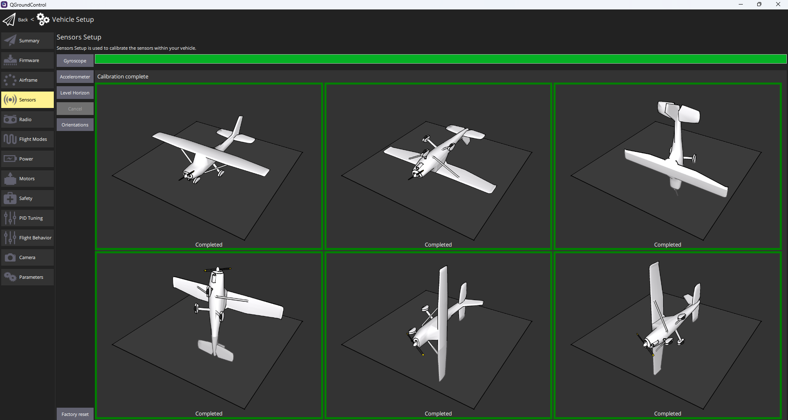

For performing PID Tuning:

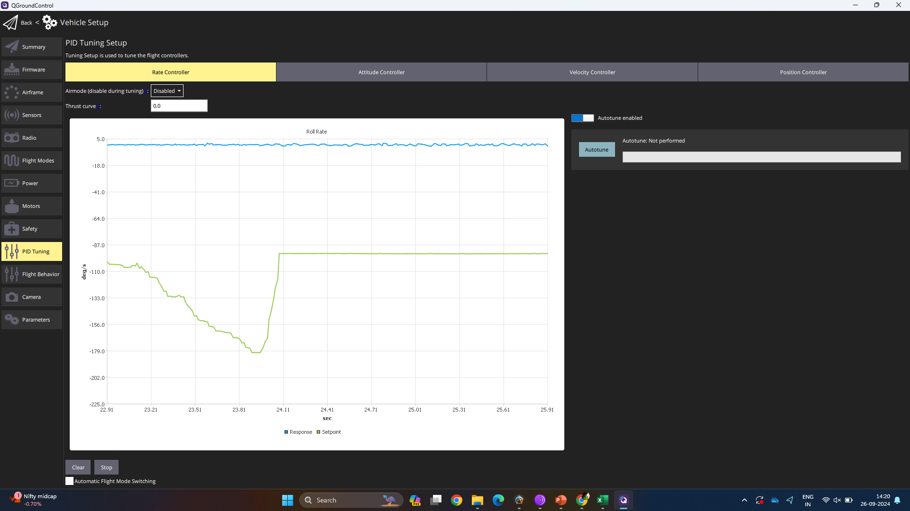

For performing Motor Setup:

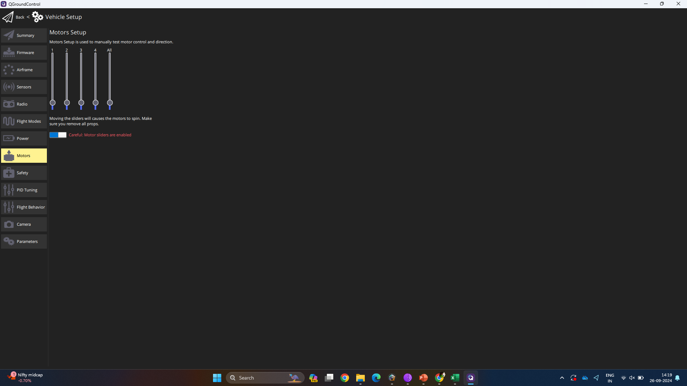

For Radio Transmission Calibration:

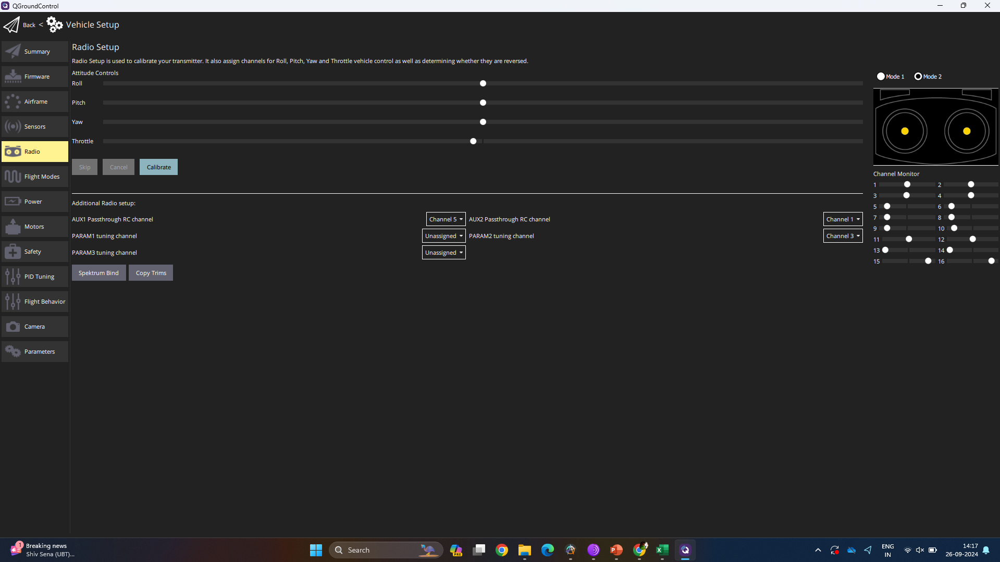

Flight mode setup:

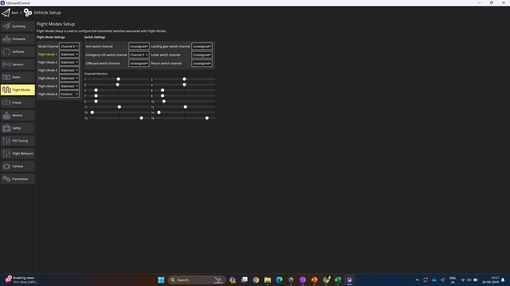

Sensor Calibration Viability: 

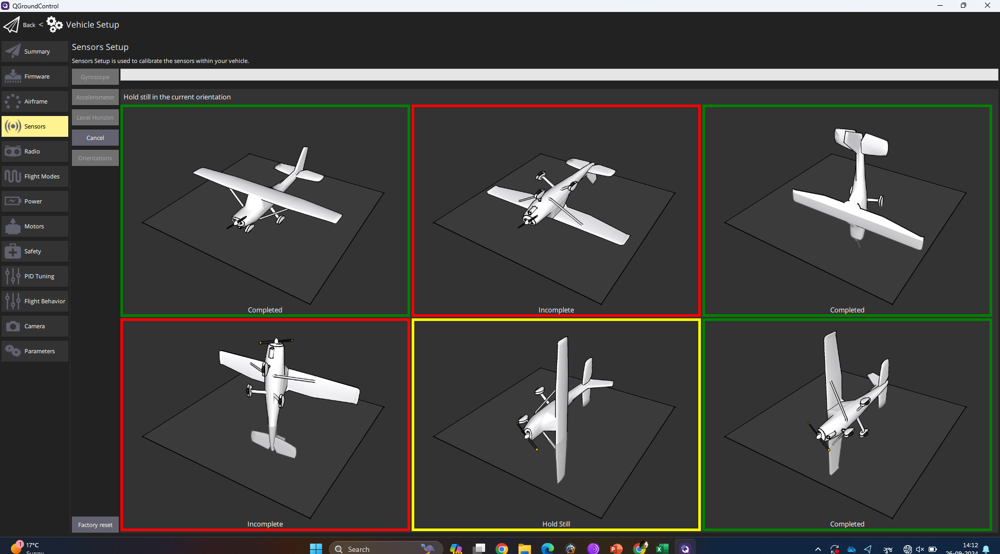

PID Tuning with working connection:

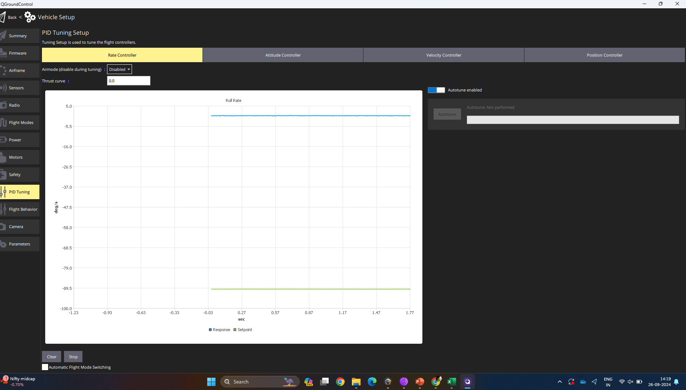

Power Setup:

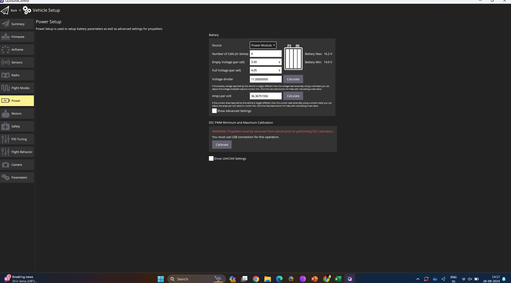

Final Summary check:

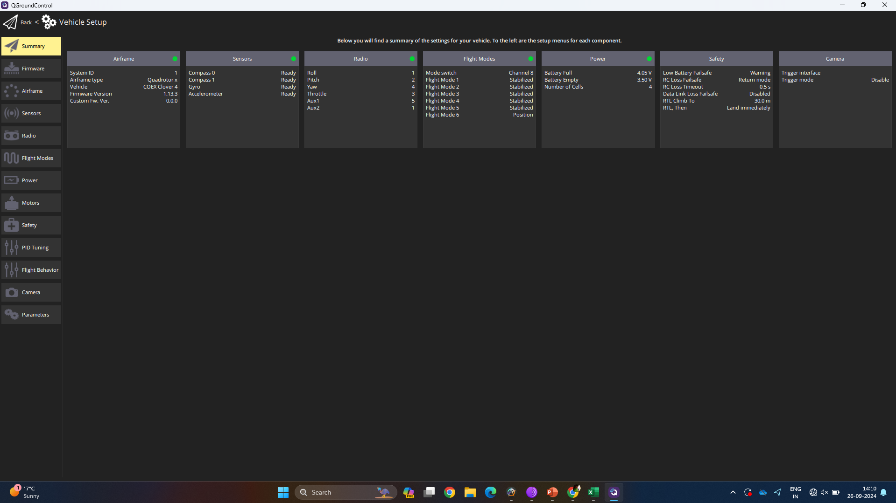


## Web Panel Preparation

For the frontend, please open:

```
cd frontend
```

Now, follow below steps:

### Project setup
```
npm install
```

### Compiles and hot-reloads for development

```
npm run serve
```

### Compiles and minifies for production

```
npm run build
```

### Lints and fixes files

```
npm run lint
```

### Finally once all preparations are done, you may get to see below output in your panel:

For the location of the Drone, you may see:

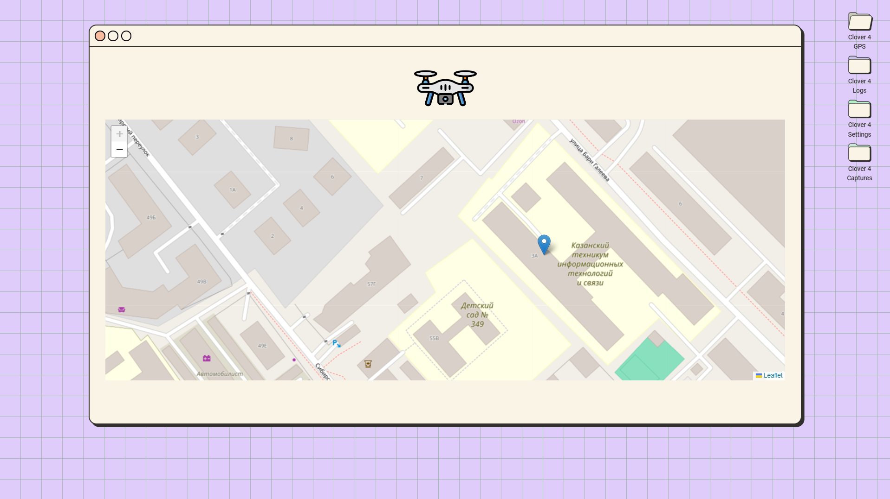

Drone Settings:

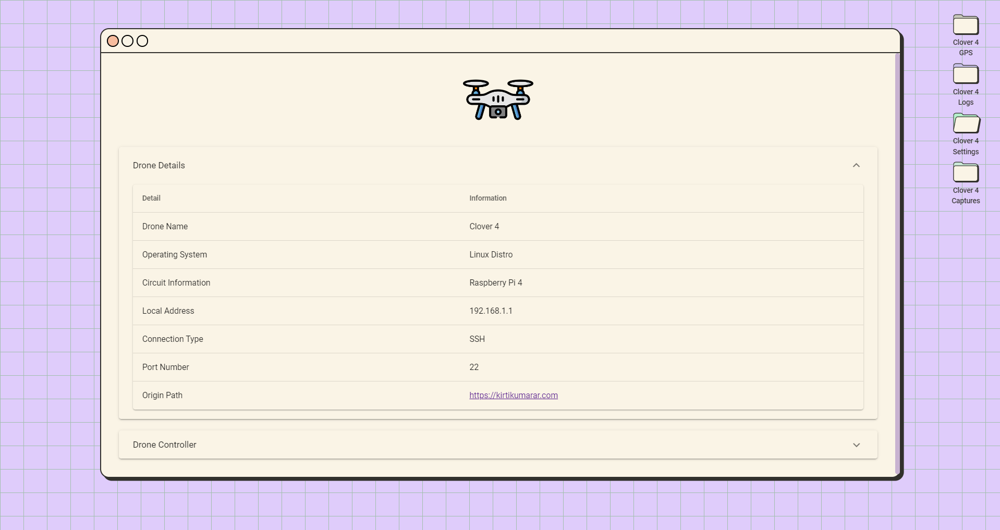

Drone Footage Capturing of Traffic Lights:

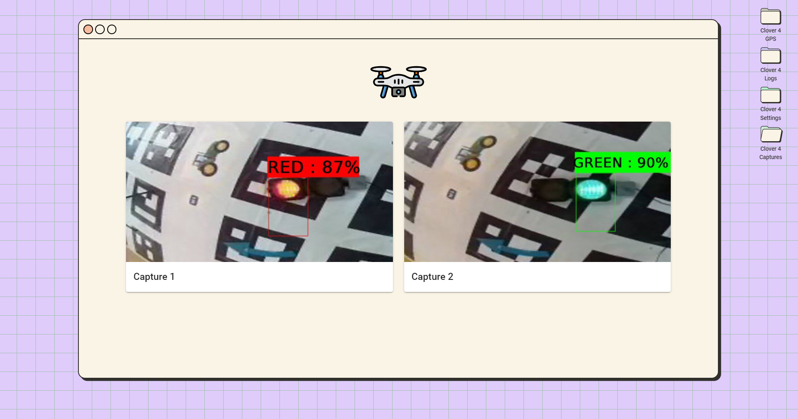
